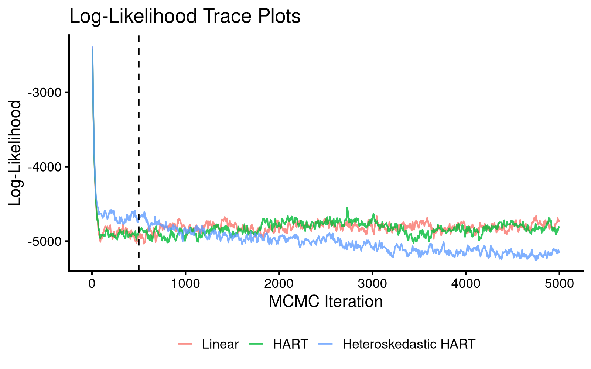
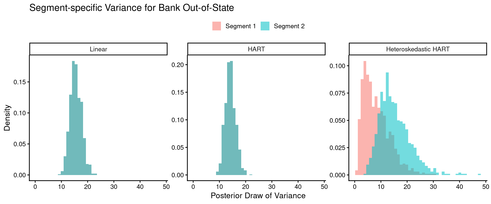
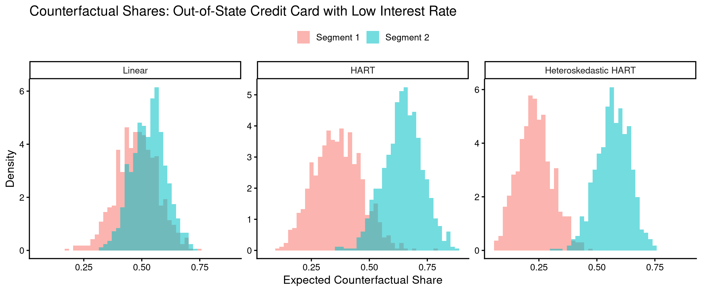

## Introduction

This vignette extends the standard `bank` example to a three-model comparison:

1. Linear hierarchical MNL ($\Delta^\top Z_i$)
2. HART mean model ($\Delta(Z_i)$)
3. Heteroskedastic HART ($\Delta(Z_i)$ and $\Sigma(Z_i)$)

The first two models differ in how they model the representative consumer. The third model additionally allows the covariance of unobserved heterogeneity to vary with demographics through tree models on the modified-Cholesky components.

## Conjoint Data of Allenby and Ginter (1995)

We use the `bank` conjoint data of Allenby and Ginter (1995): binary
choices between credit card profiles by 946 respondents, with age, income
and gender as demographics $Z$.


``` r
library(bayesm.HART)
library(bayesm)
library(tidyr)
library(dplyr)
library(ggplot2)

data(bank)
choiceAtt <- bank$choiceAtt
hh <- levels(factor(choiceAtt$id))
nhh <- length(hh)
lgtdata <- vector("list", length = nhh)
for (i in 1:nhh) {
  y <- 2 - choiceAtt[choiceAtt[, 1] == hh[i], 2]
  X_temp <- as.matrix(choiceAtt[choiceAtt[, 1] == hh[i], c(3:16)])
  X <- matrix(0, nrow = nrow(X_temp) * 2, ncol = ncol(X_temp))
  X[seq(1, nrow(X), by = 2), ] <- X_temp
  lgtdata[[i]] <- list(y = y, X = X)
}
Z <- as.matrix(bank$demo[, -1])
Z <- t(t(Z) - colMeans(Z))  # bayesm requires de-meaned Z

Data <- list(lgtdata = lgtdata, Z = Z, p = 2)
```

## MCMC Estimation: Three Models

The linear model is fitted with `bayesm::rhierMnlRwMixture`. The HART mean
model sets `hart_model = "normalized"`. The heteroskedastic model sets
`hart_model = "direct"`, which adds variance trees (`vartree`) and
off-diagonal trees (`phitree`) for $\Sigma(Z_i)$.


``` r
set.seed(2025)
R <- 20000
keep <- 20
burn <- 100  # kept draws to discard
Mcmc <- list(R = R, keep = keep)

out_lin <- bayesm::rhierMnlRwMixture(Data, Prior = list(ncomp = 1), Mcmc)
class(out_lin) <- "rhierMnlRwMixture"  # bayesm.HART methods for the bayesm fit

out_hart <- bayesm.HART::rhierMnlRwMixture(
  Data = Data, Mcmc = Mcmc,
  Prior = list(ncomp = 1, hart_model = "normalized",
               bart = list(num_trees = 20))
)

out_heter <- bayesm.HART::rhierMnlRwMixture(
  Data = Data, Mcmc = Mcmc,
  Prior = list(ncomp = 1, hart_model = "direct",
               bart = list(num_trees = 20),
               vartree = list(num_trees = 20),
               phitree = list(num_trees = 20))
)
```

The log-likelihood traces of the three models:


``` r
models <- c("Linear", "HART", "Heteroskedastic HART")
trace <- data.frame(
  Iteration = rep(seq_len(R / keep) * keep, 3),
  Model = factor(rep(models, each = R / keep), levels = models),
  LogLikelihood = c(out_lin$loglike, out_hart$loglike, out_heter$loglike)
)

ggplot(trace, aes(x = Iteration, y = LogLikelihood, color = Model)) +
  geom_line(alpha = 0.8) +
  geom_vline(xintercept = burn * keep, linetype = "dashed") +
  theme_classic(base_size = 16) +
  theme(legend.position = "bottom", legend.title = element_blank()) +
  labs(title = "Log-Likelihood Trace Plots", x = "MCMC Iteration", y = "Log-Likelihood")
```

<div class="figure" style="text-align: center">

<p class="caption">MCMC traceplot of log-likelihood across linear, HART mean, and heteroskedastic HART models.</p>
</div>

## Respondent-level Part-Worths

Following the discussion in Wiemann (2025), we examine two consumer segments defined by their demographics:

- **Segment 1** (respondent 146): older women with low income
- **Segment 2** (respondent 580): middle-aged men with moderate income

The focal coefficient is `Bank Out-of-State`.


``` r
resp <- c(146, 580)
k <- 10  # Bank Out-of-State

# Draws for the two segments under each model, in long format
by_segment <- function(lin, hart, heter) {
  bind_rows(Linear = as.data.frame(t(lin)),
            HART = as.data.frame(t(hart)),
            `Heteroskedastic HART` = as.data.frame(t(heter)),
            .id = "Model") %>%
    setNames(c("Model", "Segment 1", "Segment 2")) %>%
    pivot_longer(-Model, names_to = "Segment", values_to = "Draw") %>%
    mutate(Model = factor(Model, levels = models))
}

beta_draws <- by_segment(out_lin$betadraw[resp, k, -(1:burn)],
                         out_hart$betadraw[resp, k, -(1:burn)],
                         out_heter$betadraw[resp, k, -(1:burn)])

ggplot(beta_draws, aes(x = Draw, fill = Segment)) +
  geom_histogram(aes(y = after_stat(density)), bins = 45, alpha = 0.55,
                 position = "identity") +
  facet_wrap(~Model) +
  theme_classic(base_size = 14) +
  theme(legend.position = "top", legend.title = element_blank()) +
  labs(title = "Selected Posterior Distributions of Bank Out-of-State Part-Worths",
       x = "Coefficient Value", y = "Density")
```

<div class="figure" style="text-align: center">

<p class="caption">Posterior distributions of respondent-level out-of-state part-worths for two respondents across three models.</p>
</div>

## Segment-level Out-of-State Effects

The expected part-worth for `Bank Out-of-State` in the two selected segments:


``` r
Z_seg <- list(Z = Z[resp, ])
DeltaZ_lin   <- predict(out_lin, newdata = Z_seg, type = "DeltaZ+mu", burn = burn)
DeltaZ_hart  <- predict(out_hart, newdata = Z_seg, type = "DeltaZ+mu", burn = burn)
DeltaZ_heter <- predict(out_heter, newdata = Z_seg, type = "DeltaZ+mu", burn = burn)

deltaZ_draws <- by_segment(DeltaZ_lin[, k, ], DeltaZ_hart[, k, ], DeltaZ_heter[, k, ])

ggplot(deltaZ_draws, aes(x = Draw, fill = Segment)) +
  geom_histogram(aes(y = after_stat(density)), bins = 45, alpha = 0.55,
                 position = "identity") +
  facet_wrap(~Model, scales = "free_y") +
  theme_classic(base_size = 14) +
  theme(legend.position = "top", legend.title = element_blank()) +
  labs(title = "Expected Bank Out-of-State Part-Worth by Segment and Model",
       x = "Coefficient Value", y = "Density")
```

<div class="figure" style="text-align: center">

<p class="caption">Posterior distributions of segment-level expected out-of-state part-worths across linear, HART, and heteroskedastic HART models.</p>
</div>


``` r
deltaZ_draws %>%
  group_by(Model, Segment) %>%
  summarise(Mean = mean(Draw), P05 = quantile(Draw, 0.05),
            P95 = quantile(Draw, 0.95), .groups = "drop")
#> # A tibble: 6 × 5
#>   Model                Segment    Mean   P05   P95
#>   <fct>                <chr>     <dbl> <dbl> <dbl>
#> 1 Linear               Segment 1 -4.29 -5.38 -3.33
#> 2 Linear               Segment 2 -4.06 -4.69 -3.45
#> 3 HART                 Segment 1 -5.03 -6.59 -3.52
#> 4 HART                 Segment 2 -3.09 -4.16 -2.03
#> 5 Heteroskedastic HART Segment 1 -5.24 -6.41 -4.19
#> 6 Heteroskedastic HART Segment 2 -3.28 -3.97 -2.75

# Pr(expected part-worth of Segment 2 exceeds that of Segment 1)
c(Linear = mean(DeltaZ_lin[2, k, ] > DeltaZ_lin[1, k, ]),
  HART = mean(DeltaZ_hart[2, k, ] > DeltaZ_hart[1, k, ]),
  `Heteroskedastic HART` = mean(DeltaZ_heter[2, k, ] > DeltaZ_heter[1, k, ]))
#>               Linear                 HART Heteroskedastic HART 
#>            0.6333333            0.9688889            0.9988889
```

## Covariance Heterogeneity: $\Sigma(Z)$ vs $\Sigma$

In the heteroskedastic HART model, covariance of unobserved
heterogeneity varies with demographics through tree models on
modified-Cholesky components. We compare posterior variances for the
focal out-of-state part-worth across all three models with
`predict(type = "SigmaZ")`. For linear and HART, covariance is
homoskedastic, so the two segments share one variance distribution;
heteroskedastic HART yields segment-specific distributions.


``` r
Sigma_lin   <- predict(out_lin, newdata = Z_seg, type = "SigmaZ", burn = burn)
Sigma_hart  <- predict(out_hart, newdata = Z_seg, type = "SigmaZ", burn = burn)
Sigma_heter <- predict(out_heter, newdata = Z_seg, type = "SigmaZ", burn = burn)

var_draws <- by_segment(Sigma_lin[, k, k, ], Sigma_hart[, k, k, ], Sigma_heter[, k, k, ])

ggplot(var_draws, aes(x = Draw, fill = Segment)) +
  geom_histogram(aes(y = after_stat(density)), bins = 45, alpha = 0.55,
                 position = "identity") +
  facet_wrap(~Model, scales = "free_y") +
  theme_classic(base_size = 14) +
  theme(legend.position = "top", legend.title = element_blank()) +
  labs(title = "Segment-specific Variance for Bank Out-of-State",
       x = "Posterior Draw of Variance", y = "Density")
```

<div class="figure" style="text-align: center">

<p class="caption">Posterior variance distributions for the focal part-worth across linear, HART, and heteroskedastic HART models.</p>
</div>


``` r
var_draws %>%
  group_by(Model, Segment) %>%
  summarise(Mean = mean(Draw), P05 = quantile(Draw, 0.05),
            P95 = quantile(Draw, 0.95), .groups = "drop")
#> # A tibble: 6 × 5
#>   Model                Segment    Mean   P05   P95
#>   <fct>                <chr>     <dbl> <dbl> <dbl>
#> 1 Linear               Segment 1 15.5  12.1   19.2
#> 2 Linear               Segment 2 15.5  12.1   19.2
#> 3 HART                 Segment 1 14.2  11.2   17.5
#> 4 HART                 Segment 2 14.2  11.2   17.5
#> 5 Heteroskedastic HART Segment 1  8.33  2.15  17.7
#> 6 Heteroskedastic HART Segment 2 15.3   7.46  26.0

# Variance of Segment 2 relative to Segment 1 under heteroskedastic HART
ratio <- Sigma_heter[2, k, k, ] / Sigma_heter[1, k, k, ]
c(`Pr(ratio > 1)` = mean(ratio > 1), `Median ratio` = median(ratio))
#> Pr(ratio > 1)  Median ratio 
#>     0.8344444     1.9775069
```

## Counterfactual Shares of Out-of-State Credit Card Offerings

Following Wiemann (2025, Section 5.3), we consider the design of an out-of-state credit card that is most likely to succeed against existing offerings. We compute expected counterfactual shares for potential offerings against a baseline in-state credit card. These counterfactuals capture the demand response through both observed preference heterogeneity via $\Delta(\cdot)$ and unobserved preference heterogeneity---including correlated preferences---captured by $\Sigma$ (or $\Sigma(Z)$ for the heteroskedastic model).


``` r
set.seed(2025)

# Attributes switched on for the out-of-state card (10 = out-of-state bank,
# 2 = low fixed interest, 8 = low annual fee); the baseline card has none.
scenarios <- list("Out-of-State Bank" = 10,
                  "Out-of-State & Low Interest" = c(2, 10),
                  "Out-of-State & Low Annual Fee" = c(8, 10))
fits <- list(Linear = out_lin, HART = out_hart, `Heteroskedastic HART` = out_heter)

cf <- list()
for (scenario in names(scenarios)) {
  X <- matrix(0, nrow = 2, ncol = 14)
  X[1, scenarios[[scenario]]] <- 1
  for (model in models) {
    probs <- predict(fits[[model]],
                     newdata = list(Z = Z_seg$Z, X = list(X, X), p = 2),
                     mode = "prior", type = "choice_probs", burn = burn, nsim = 50)
    shares <- cbind(probs[[1]][1, 1, ], probs[[2]][1, 1, ])  # out-of-state card
    cf[[paste(scenario, model)]] <- data.frame(
      Scenario = scenario, Model = model,
      Segment = rep(c("Segment 1", "Segment 2"), each = nrow(shares)),
      Share = c(shares)
    )
  }
}
cf <- bind_rows(cf) %>% mutate(Model = factor(Model, levels = models))
```

Posterior means and standard deviations of the shares, as in Table 3 of Wiemann (2025):


``` r
cf %>%
  group_by(Scenario, Segment, Model) %>%
  summarise(Share = sprintf("%.2f (%.2f)", mean(Share), sd(Share)), .groups = "drop") %>%
  pivot_wider(names_from = Model, values_from = Share) %>%
  as.data.frame()
#>                        Scenario   Segment      Linear        HART
#> 1 Out-of-State & Low Annual Fee Segment 1 0.52 (0.08) 0.45 (0.10)
#> 2 Out-of-State & Low Annual Fee Segment 2 0.48 (0.07) 0.55 (0.09)
#> 3   Out-of-State & Low Interest Segment 1 0.48 (0.09) 0.36 (0.10)
#> 4   Out-of-State & Low Interest Segment 2 0.53 (0.07) 0.64 (0.08)
#> 5             Out-of-State Bank Segment 1 0.16 (0.05) 0.12 (0.06)
#> 6             Out-of-State Bank Segment 2 0.18 (0.05) 0.23 (0.07)
#>   Heteroskedastic HART
#> 1          0.35 (0.11)
#> 2          0.51 (0.07)
#> 3          0.23 (0.07)
#> 4          0.57 (0.07)
#> 5          0.06 (0.05)
#> 6          0.22 (0.06)
```

The out-of-state card with a low interest rate, as in Figure 6 of Wiemann (2025):


``` r
ggplot(filter(cf, Scenario == "Out-of-State & Low Interest"),
       aes(x = Share, fill = Segment)) +
  geom_histogram(aes(y = after_stat(density)), bins = 45, alpha = 0.55,
                 position = "identity") +
  facet_wrap(~Model, scales = "free_y") +
  theme_classic(base_size = 14) +
  theme(legend.position = "top", legend.title = element_blank()) +
  labs(title = "Counterfactual Shares: Out-of-State Credit Card with Low Interest Rate",
       x = "Expected Counterfactual Share", y = "Density")
```

<div class="figure" style="text-align: center">

<p class="caption">Posterior distributions of expected counterfactual shares of an out-of-state credit card with low interest rate against a baseline in-state credit card.</p>
</div>

## Quantifying Explained Variance ($R^2$)

To quantify explained demographic heterogeneity, we compute a Bayesian
$R^2$ measure. This is the fraction of latent preference heterogeneity
explained by observed demographics $Z$. For heteroskedastic HART,
$R^2$ is respondent-specific because $\Sigma(Z_i)$ varies across $i$;
the plot shows its posterior mean for each respondent.


``` r
smry_lin   <- summary(out_lin, Z = Z, burn = burn, coefs = k)
smry_hart  <- summary(out_hart, Z = Z, burn = burn, coefs = k)
smry_heter <- summary(out_heter, Z = Z, burn = burn, coefs = k)

r2 <- bind_rows(
  data.frame(Model = "Linear", R2 = smry_lin$r2$R2_draws[, 1]),
  data.frame(Model = "HART", R2 = smry_hart$r2$R2_draws[, 1]),
  data.frame(Model = "Heteroskedastic HART", R2 = colMeans(smry_heter$r2$R2_draws[[1]]))
) %>%
  mutate(Model = factor(Model, levels = models))

ggplot(r2, aes(x = R2, fill = Model)) +
  geom_density(alpha = 0.45) +
  theme_classic(base_size = 14) +
  theme(legend.position = "top", legend.title = element_blank()) +
  labs(title = "Variance Explained by Demographics for Bank Out-of-State",
       x = expression(R^2), y = "Density")
```

<div class="figure" style="text-align: center">

<p class="caption">Posterior distributions of explained variance for the focal part-worth.</p>
</div>

``` r

# Mean R2
tapply(r2$R2, r2$Model, mean)
#>               Linear                 HART Heteroskedastic HART 
#>           0.01736113           0.05840664           0.03604333
```

## Cross-Respondent Uncertainty

We compare respondent-level uncertainty in segment predictions by model. For each respondent, we compute the posterior SD of the expected part-worth $\mu + \Delta(Z_i)$ for the focal coefficient and then inspect the cross-respondent distribution of those SD values.


``` r
# Posterior SD of mu + Delta(Z_i) for every respondent
posterior_sd <- function(fit) {
  DeltaZ <- predict(fit, newdata = list(Z = Z), type = "DeltaZ+mu", burn = burn)
  apply(DeltaZ[, k, ], 1, sd)
}

uncertainty <- data.frame(
  Model = factor(rep(models, each = nrow(Z)), levels = models),
  SD = c(posterior_sd(out_lin), posterior_sd(out_hart), posterior_sd(out_heter))
)

ggplot(uncertainty, aes(x = SD, fill = Model)) +
  geom_density(alpha = 0.35) +
  theme_classic(base_size = 14) +
  theme(legend.position = "bottom", legend.title = element_blank()) +
  labs(title = "Cross-Respondent Distribution of Posterior SD for Bank Out-of-State",
       x = "Posterior SD of Segment-level Prediction", y = "Density")
```

<div class="figure" style="text-align: center">

<p class="caption">Distribution across respondents of posterior SD for segment-level focal part-worth predictions.</p>
</div>

## References

Allenby, Greg M. and James L. Ginter (1995). "Using Extremes to Design Products and Segment Markets." Journal of Marketing Research 32(4), pp. 392--403.

Rossi, Peter E., Greg M. Allenby, and Robert McCulloch (2009). Bayesian Statistics and Marketing. Reprint. Wiley Series in Probability and Statistics. Chichester: Wiley.

Wiemann, Thomas (2025). "[Personalization with HART](https://thomaswiemann.com/assets/pdfs/jmp_wiemann.pdf)." Working paper.

