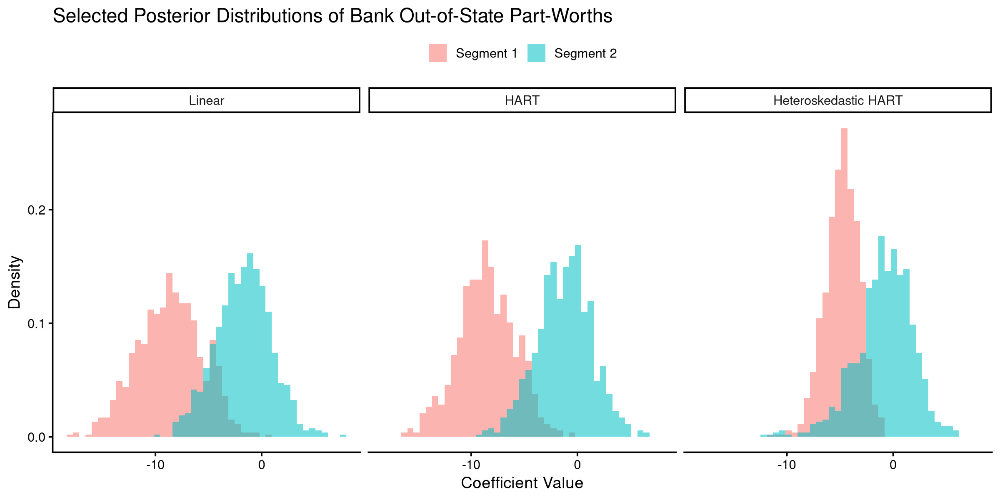
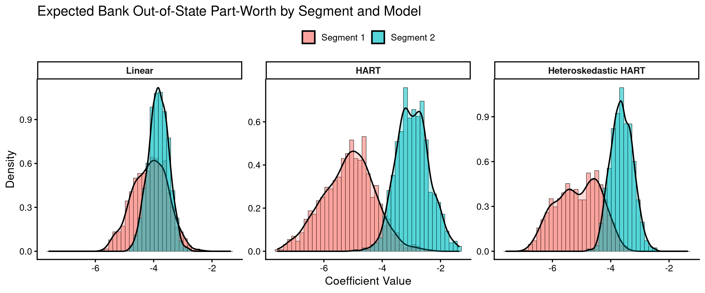
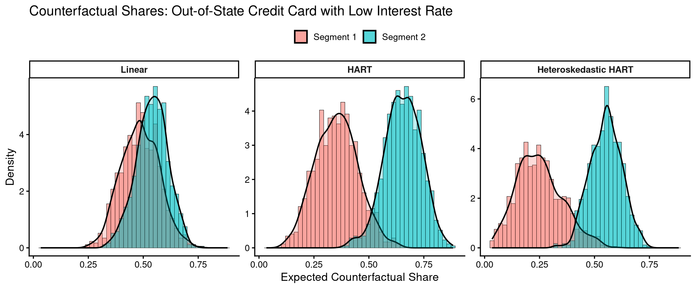
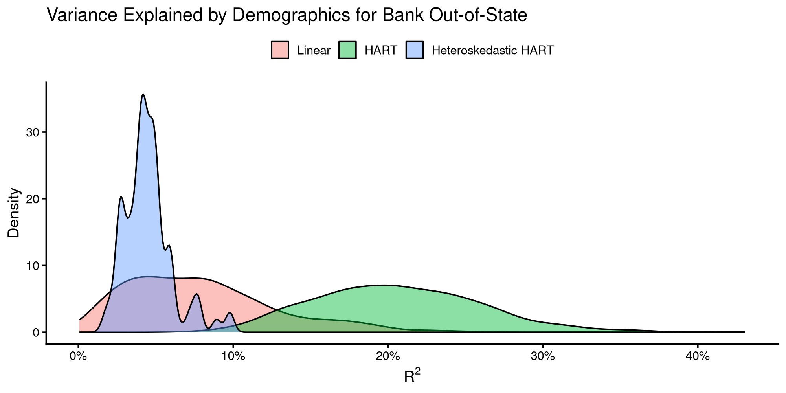
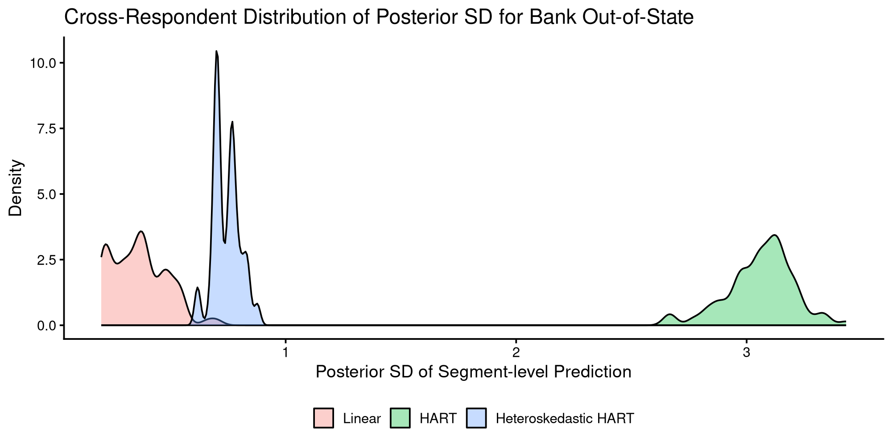

## Introduction

This vignette extends the standard `bank` example to a three-model comparison:

1. Linear hierarchical MNL ($\Delta^\top Z_i$)
2. HART mean model ($\Delta(Z_i)$)
3. Heteroskedastic HART ($\Delta(Z_i)$ and $\Sigma(Z_i)$)

The first two models differ in how they model the representative consumer. The third model additionally allows the covariance of unobserved heterogeneity to vary with demographics through tree models on the modified-Cholesky components.

## Conjoint Data of Allenby and Ginter (1995)

We use the `bank` conjoint data of Allenby and Ginter (1995): binary
choices between credit card profiles by 946 respondents, with age, income
and gender as demographics $Z$.


``` r
library(bayesm.HART)
library(bayesm)
#> 
#> Attaching package: 'bayesm'
#> The following objects are masked from 'package:bayesm.HART':
#> 
#>     rhierLinearMixture, rhierMnlRwMixture, rhierNegbinRw
library(tidyr)
library(dplyr)
#> 
#> Attaching package: 'dplyr'
#> The following objects are masked from 'package:stats':
#> 
#>     filter, lag
#> The following objects are masked from 'package:base':
#> 
#>     intersect, setdiff, setequal, union
library(ggplot2)

data(bank)
choiceAtt <- bank$choiceAtt
hh <- levels(factor(choiceAtt$id))
nhh <- length(hh)
lgtdata <- vector("list", length = nhh)
for (i in 1:nhh) {
  y <- 2 - choiceAtt[choiceAtt[, 1] == hh[i], 2]
  X_temp <- as.matrix(choiceAtt[choiceAtt[, 1] == hh[i], c(3:16)])
  X <- matrix(0, nrow = nrow(X_temp) * 2, ncol = ncol(X_temp))
  X[seq(1, nrow(X), by = 2), ] <- X_temp
  lgtdata[[i]] <- list(y = y, X = X)
}
Z <- as.matrix(bank$demo[, -1])
Z <- t(t(Z) - colMeans(Z))  # bayesm requires de-meaned Z

Data <- list(lgtdata = lgtdata, Z = Z, p = 2)
```

## MCMC Estimation: Three Models

The linear model is fitted with `bayesm::rhierMnlRwMixture`. The HART mean
model sets `hart_model = "normalized"`. The heteroskedastic model sets
`hart_model = "direct"`, which adds variance trees (`vartree`) and
off-diagonal trees (`phitree`) for $\Sigma(Z_i)$.


``` r
R <- 5000
burn <- 500
keep <- 5
Mcmc <- list(R = R, keep = keep)

out_lin <- bayesm::rhierMnlRwMixture(Data, Prior = list(ncomp = 1), Mcmc)
class(out_lin) <- "rhierMnlRwMixture"  # bayesm.HART methods for the bayesm fit

out_hart <- bayesm.HART::rhierMnlRwMixture(
  Data = Data, Mcmc = Mcmc,
  Prior = list(ncomp = 1, hart_model = "normalized",
               bart = list(num_trees = 20)),
  r_verbose = FALSE
)

out_heter <- bayesm.HART::rhierMnlRwMixture(
  Data = Data, Mcmc = Mcmc,
  Prior = list(ncomp = 1, hart_model = "direct",
               bart = list(num_trees = 20),
               vartree = list(num_trees = 20),
               phitree = list(num_trees = 20)),
  r_verbose = FALSE
)
```

The log-likelihood traces of the three models:


``` r
burnin_draws <- ceiling(burn / keep)

mcmc_data <- data.frame(
  Iteration = (1:length(out_lin$loglike)) * keep,
  Linear = out_lin$loglike,
  HART = out_hart$loglike,
  HeteroskedasticHART = out_heter$loglike
) %>%
  pivot_longer(
    cols = c("Linear", "HART", "HeteroskedasticHART"),
    names_to = "Model",
    values_to = "LogLikelihood"
  ) %>%
  mutate(
    Model = recode(Model, HeteroskedasticHART = "Heteroskedastic HART"),
    Model = factor(Model, levels = c("Linear", "HART", "Heteroskedastic HART"))
  )

ggplot(mcmc_data, aes(x = Iteration, y = LogLikelihood, color = Model)) +
  geom_line(alpha = 0.8) +
  geom_vline(xintercept = burn, linetype = "dashed", color = "black") +
  theme_classic(base_size = 16) +
  labs(title = "Log-Likelihood Trace Plots", x = "MCMC Iteration", y = "Log-Likelihood") +
  theme(legend.title = element_blank(), legend.position = "bottom")
```

<div class="figure" style="text-align: center">

<p class="caption">MCMC traceplot of log-likelihood across linear, HART mean, and heteroskedastic HART models.</p>
</div>

## Respondent-level Part-Worths

Following the discussion in Wiemann (2025), we examine two consumer segments defined by their demographics:

- **Segment 1** (respondent 146): older women with low income
- **Segment 2** (respondent 580): middle-aged men with moderate income

The focal coefficient is `Bank Out-of-State`.


``` r
selected_resp <- c(146, 580)
coef_indx <- 10
coef_label <- "Bank Out-of-State"

beta_draws <- bind_rows(
  as.data.frame(t(out_lin$betadraw[selected_resp, coef_indx, -c(1:burnin_draws)])) %>%
    mutate(Model = "Linear", Draw = row_number()),
  as.data.frame(t(out_hart$betadraw[selected_resp, coef_indx, -c(1:burnin_draws)])) %>%
    mutate(Model = "HART", Draw = row_number()),
  as.data.frame(t(out_heter$betadraw[selected_resp, coef_indx, -c(1:burnin_draws)])) %>%
    mutate(Model = "Heteroskedastic HART", Draw = row_number())
) %>%
  mutate(Model = factor(Model, levels = c("Linear", "HART", "Heteroskedastic HART")))
colnames(beta_draws)[1:2] <- paste("Segment", 1:2)

beta_draws_long <- beta_draws %>%
  pivot_longer(cols = starts_with("Segment"), names_to = "Segment", values_to = "Coefficient")

ggplot(beta_draws_long, aes(x = Coefficient, fill = Segment)) +
  geom_histogram(aes(y = after_stat(density)), bins = 45, alpha = 0.55,
                 position = "identity", color = "black", linewidth = 0.2) +
  facet_wrap(~Model, ncol = 3) +
  theme_classic(base_size = 14) +
  labs(
    title = paste("Selected Posterior Distributions of", coef_label, "Part-Worths"),
    x = "Coefficient Value",
    y = "Density"
  ) +
  theme(legend.position = "top", legend.title = element_blank())
```

<div class="figure" style="text-align: center">

<p class="caption">Posterior distributions of respondent-level out-of-state part-worths for two respondents across three models.</p>
</div>

## Segment-level Out-of-State Effects

The expected part-worth for `Bank Out-of-State` in the two selected segments:


``` r
Data_seg <- list(Z = Z[selected_resp, , drop = FALSE])
DeltaZ_lin <- predict(out_lin, newdata = Data_seg, type = "DeltaZ+mu",
                      burn = burnin_draws, r_verbose = FALSE)
DeltaZ_hart <- predict(out_hart, newdata = Data_seg, type = "DeltaZ+mu",
                       burn = burnin_draws, r_verbose = FALSE)
DeltaZ_heter <- predict(out_heter, newdata = Data_seg, type = "DeltaZ+mu",
                        burn = burnin_draws, r_verbose = FALSE)
SigmaZ_heter <- predict(out_heter, newdata = Data_seg, type = "SigmaZ",
                        burn = burnin_draws, r_verbose = FALSE)
```


``` r
segment_coef_df <- bind_rows(
  data.frame(
    Model = "Linear",
    Segment = "Segment 1",
    Coefficient = DeltaZ_lin[1, coef_indx, ]
  ),
  data.frame(
    Model = "Linear",
    Segment = "Segment 2",
    Coefficient = DeltaZ_lin[2, coef_indx, ]
  ),
  data.frame(
    Model = "HART",
    Segment = "Segment 1",
    Coefficient = DeltaZ_hart[1, coef_indx, ]
  ),
  data.frame(
    Model = "HART",
    Segment = "Segment 2",
    Coefficient = DeltaZ_hart[2, coef_indx, ]
  ),
  data.frame(
    Model = "Heteroskedastic HART",
    Segment = "Segment 1",
    Coefficient = DeltaZ_heter[1, coef_indx, ]
  ),
  data.frame(
    Model = "Heteroskedastic HART",
    Segment = "Segment 2",
    Coefficient = DeltaZ_heter[2, coef_indx, ]
  )
) %>%
  mutate(
    Model = factor(Model, levels = c("Linear", "HART", "Heteroskedastic HART")),
    Segment = factor(Segment, levels = c("Segment 1", "Segment 2"))
  )

ggplot(segment_coef_df, aes(x = Coefficient, fill = Segment)) +
  geom_histogram(
    aes(y = after_stat(density)),
    bins = 45,
    alpha = 0.55,
    position = "identity",
    color = "black",
    linewidth = 0.2
  ) +
  geom_density(alpha = 0.25, linewidth = 0.8) +
  facet_wrap(~Model, ncol = 3, scales = "free_y") +
  theme_classic(base_size = 14) +
  labs(
    title = paste("Expected", coef_label, "Part-Worth by Segment and Model"),
    x = "Coefficient Value",
    y = "Density"
  ) +
  theme(
    legend.position = "top",
    legend.title = element_blank(),
    strip.text = element_text(face = "bold")
  )
```

<div class="figure" style="text-align: center">

<p class="caption">Posterior distributions of segment-level expected out-of-state part-worths across linear, HART, and heteroskedastic HART models.</p>
</div>


``` r
coef_summary <- segment_coef_df %>%
  group_by(Model, Segment) %>%
  summarise(
    Mean = mean(Coefficient),
    Median = median(Coefficient),
    P05 = quantile(Coefficient, 0.05),
    P95 = quantile(Coefficient, 0.95),
    .groups = "drop"
  )
print(coef_summary, digits = 3)
#> # A tibble: 6 × 6
#>   Model                Segment    Mean Median   P05   P95
#>   <fct>                <fct>     <dbl>  <dbl> <dbl> <dbl>
#> 1 Linear               Segment 1 -4.13  -4.10 -5.13 -3.19
#> 2 Linear               Segment 2 -3.84  -3.83 -4.42 -3.28
#> 3 HART                 Segment 1 -5.15  -5.09 -6.64 -3.73
#> 4 HART                 Segment 2 -2.95  -2.95 -3.81 -1.99
#> 5 Heteroskedastic HART Segment 1 -5.11  -5.08 -6.32 -3.97
#> 6 Heteroskedastic HART Segment 2 -3.62  -3.63 -4.21 -3.00

coef_diff_lin <- DeltaZ_lin[2, coef_indx, ] - DeltaZ_lin[1, coef_indx, ]
coef_diff_hart <- DeltaZ_hart[2, coef_indx, ] - DeltaZ_hart[1, coef_indx, ]
coef_diff_heter <- DeltaZ_heter[2, coef_indx, ] - DeltaZ_heter[1, coef_indx, ]
cat("Pr(Expected part-worth Segment 2 > Segment 1):\n")
#> Pr(Expected part-worth Segment 2 > Segment 1):
cat("  Linear =", round(mean(coef_diff_lin > 0), 3), "\n")
#>   Linear = 0.691
cat("  HART =", round(mean(coef_diff_hart > 0), 3), "\n")
#>   HART = 0.987
cat("  Heteroskedastic HART =", round(mean(coef_diff_heter > 0), 3), "\n")
#>   Heteroskedastic HART = 0.983
```

## Covariance Heterogeneity: $\Sigma(Z)$ vs $\Sigma$

In the heteroskedastic HART model, covariance of unobserved
heterogeneity varies with demographics through tree models on
modified-Cholesky components. We compare posterior variances for the
focal out-of-state part-worth across all three models. For linear and
HART, covariance is homoskedastic, so each model contributes one common
variance distribution; heteroskedastic HART yields segment-specific
distributions.


``` r
common_var_draws <- function(fit) {
  kept <- fit$nmix$compdraw[-seq_len(burnin_draws)]
  vapply(kept, function(d) solve(crossprod(d[[1]]$rooti))[coef_indx, coef_indx],
         numeric(1))
}

segment_var_draws <- lapply(seq_len(nrow(Data_seg$Z)), function(i) {
  SigmaZ_heter[i, coef_indx, coef_indx, ]
})

lin_var_draws <- common_var_draws(out_lin)
hart_var_draws <- common_var_draws(out_hart)

segment_labels <- c("Segment 1", "Segment 2")
var_df <- bind_rows(
  data.frame(
    Model = "Heteroskedastic HART",
    Segment = segment_labels[1],
    Variance = segment_var_draws[[1]]
  ),
  data.frame(
    Model = "Heteroskedastic HART",
    Segment = segment_labels[2],
    Variance = segment_var_draws[[2]]
  ),
  data.frame(
    Model = "Linear",
    Segment = "Common (homoskedastic)",
    Variance = lin_var_draws
  ),
  data.frame(
    Model = "HART",
    Segment = "Common (homoskedastic)",
    Variance = hart_var_draws
  )
) %>%
  mutate(
    Model = factor(Model, levels = c("Linear", "HART", "Heteroskedastic HART"))
  )

ggplot(var_df, aes(x = Variance, fill = Segment)) +
  geom_histogram(
    aes(y = after_stat(density)),
    bins = 45,
    alpha = 0.55,
    position = "identity",
    color = "black",
    linewidth = 0.2
  ) +
  geom_density(alpha = 0.25, linewidth = 0.8) +
  facet_wrap(~Model, ncol = 3, scales = "free_y") +
  theme_classic(base_size = 14) +
  labs(
    title = paste("Segment-specific Variance for", coef_label),
    x = "Posterior Draw of Variance",
    y = "Density"
  ) +
  theme(
    legend.position = "top",
    legend.title = element_blank(),
    strip.text = element_text(face = "bold")
  )
```

<div class="figure" style="text-align: center">

<p class="caption">Posterior variance distributions for the focal part-worth across linear, HART, and heteroskedastic HART models.</p>
</div>


``` r
variance_summary <- var_df %>%
  group_by(Model, Segment) %>%
  summarise(
    Mean = mean(Variance),
    Median = median(Variance),
    P05 = quantile(Variance, 0.05),
    P95 = quantile(Variance, 0.95),
    .groups = "drop"
  )
print(variance_summary, digits = 3)
#> # A tibble: 4 × 6
#>   Model                Segment                 Mean Median   P05   P95
#>   <fct>                <chr>                  <dbl>  <dbl> <dbl> <dbl>
#> 1 Linear               Common (homoskedastic)  3.89   3.96  2.56  5.13
#> 2 HART                 Common (homoskedastic)  2.72   2.47  1.75  3.97
#> 3 Heteroskedastic HART Segment 1              13.3   12.3   4.77 25.2 
#> 4 Heteroskedastic HART Segment 2              15.4   14.0   6.62 28.4

variance_ratio <- segment_var_draws[[2]] / segment_var_draws[[1]]
cat("Pr(Variance Segment 2 > Segment 1) =",
    round(mean(variance_ratio > 1), 3), "\n")
#> Pr(Variance Segment 2 > Segment 1) = 0.55
cat("Median variance ratio (Segment 2 / Segment 1) =",
    round(median(variance_ratio), 3), "\n")
#> Median variance ratio (Segment 2 / Segment 1) = 1.162
```

The heteroskedastic HART model includes additional tree ensembles for covariance components.


``` r
nvar <- dim(out_heter$betadraw)[2]
phi_edge_count <- sum(lengths(out_heter$phi_models))

cat("Heteroskedastic HART covariance model summary:\n")
#> Heteroskedastic HART covariance model summary:
cat("Number of coefficients (nvar):", nvar, "\n")
#> Number of coefficients (nvar): 14
cat("Number of variance-tree ensembles:", length(out_heter$var_models), "\n")
#> Number of variance-tree ensembles: 14
cat("Number of off-diagonal phi tree ensembles:", phi_edge_count, "\n")
#> Number of off-diagonal phi tree ensembles: 91
```

## Counterfactual Shares of Out-of-State Credit Card Offerings

Following Wiemann (2025, Section 5.3), we consider the design of an out-of-state credit card that is most likely to succeed against existing offerings. We compute expected counterfactual shares for potential offerings against a baseline in-state credit card. These counterfactuals capture the demand response through both observed preference heterogeneity via $\Delta(\cdot)$ and unobserved preference heterogeneity---including correlated preferences---captured by $\Sigma$ (or $\Sigma(Z)$ for the heteroskedastic model).


``` r
# Out-of-State Bank only
X_oos <- matrix(0, 2, nvar)
X_oos[1, 10] <- 1

# Out-of-State Bank and Low Interest
X_oos_int <- matrix(0, 2, nvar)
X_oos_int[1, c(2, 10)] <- 1

# Out-of-State Bank and Low Annual Fee
X_oos_fee <- matrix(0, 2, nvar)
X_oos_fee[1, c(8, 10)] <- 1

scenarios <- list(
  "Out-of-State Bank" = X_oos,
  "Out-of-State & Low Interest" = X_oos_int,
  "Out-of-State & Low Annual Fee" = X_oos_fee
)

models_list <- list(Linear = out_lin, HART = out_hart, `Heteroskedastic HART` = out_heter)

cf_results <- list()
for (sc_name in names(scenarios)) {
  X_cf <- scenarios[[sc_name]]
  for (mod_name in names(models_list)) {
    probs <- predict(
      models_list[[mod_name]],
      newdata = list(
        Z = Data_seg$Z,
        X = list(X_cf, X_cf),
        p = 2
      ),
      mode = "prior", type = "choice_probs", burn = burnin_draws, nsim = 50, r_verbose = FALSE
    )
    for (seg in 1:2) {
      # probs[[seg]] is [1, 2, ndraws]: Pr(alt 1 = out-of-state card)
      share_draws <- probs[[seg]][1, 1, ]
      cf_results[[length(cf_results) + 1]] <- data.frame(
        Scenario = sc_name,
        Model = mod_name,
        Segment = paste("Segment", seg),
        Share = share_draws
      )
    }
  }
}
cf_df <- bind_rows(cf_results) %>%
  mutate(
    Model = factor(Model, levels = c("Linear", "HART", "Heteroskedastic HART")),
    Segment = factor(Segment, levels = c("Segment 1", "Segment 2"))
  )

# As Table 3 of Wiemann (2025)
cf_summary <- cf_df %>%
  group_by(Scenario, Model, Segment) %>%
  summarise(
    Mean = round(mean(Share), 2),
    SD = round(sd(Share), 2),
    .groups = "drop"
  ) %>%
  mutate(Est = sprintf("%.2f (%.2f)", Mean, SD)) %>%
  select(Scenario, Model, Segment, Est) %>%
  pivot_wider(names_from = c(Segment, Model), values_from = Est)
print(cf_summary)
#> # A tibble: 3 × 7
#>   Scenario                `Segment 1_Linear` `Segment 2_Linear` `Segment 1_HART`
#>   <chr>                   <chr>              <chr>              <chr>           
#> 1 Out-of-State & Low Ann… 0.53 (0.08)        0.48 (0.07)        0.45 (0.10)     
#> 2 Out-of-State & Low Int… 0.49 (0.08)        0.54 (0.07)        0.34 (0.10)     
#> 3 Out-of-State Bank       0.16 (0.05)        0.18 (0.05)        0.10 (0.05)     
#> # ℹ 3 more variables: `Segment 2_HART` <chr>,
#> #   `Segment 1_Heteroskedastic HART` <chr>,
#> #   `Segment 2_Heteroskedastic HART` <chr>

# As Figure 6 of Wiemann (2025)
cf_plot_df <- cf_df %>%
  filter(Scenario == "Out-of-State & Low Interest")

ggplot(cf_plot_df, aes(x = Share, fill = Segment)) +
  geom_histogram(
    aes(y = after_stat(density)),
    bins = 45, alpha = 0.55, position = "identity",
    color = "black", linewidth = 0.2
  ) +
  geom_density(alpha = 0.25, linewidth = 0.8) +
  facet_wrap(~Model, ncol = 3, scales = "free_y") +
  theme_classic(base_size = 14) +
  labs(
    title = "Counterfactual Shares: Out-of-State Credit Card with Low Interest Rate",
    x = "Expected Counterfactual Share",
    y = "Density"
  ) +
  theme(
    legend.position = "top",
    legend.title = element_blank(),
    strip.text = element_text(face = "bold")
  )
```

<div class="figure" style="text-align: center">

<p class="caption">Posterior distributions of expected counterfactual shares of an out-of-state credit card with low interest rate against a baseline in-state credit card.</p>
</div>

## Quantifying Explained Variance ($R^2$)

To quantify explained demographic heterogeneity, we compute a Bayesian
$R^2$ measure. This is the fraction of latent preference heterogeneity
explained by observed demographics $Z$. For heteroskedastic HART,
$R^2$ is respondent-specific because $\Sigma(Z_i)$ varies across $i$.


``` r
smry_lin   <- summary(out_lin, Z = Z, burn = burnin_draws, coefs = coef_indx)
smry_hart  <- summary(out_hart, Z = Z, burn = burnin_draws, coefs = coef_indx)
smry_heter <- summary(out_heter, Z = Z, burn = burnin_draws, coefs = coef_indx)

# Under heteroskedastic covariance R2_draws is a list of per-coefficient
# matrices; the plot uses the per-respondent posterior mean.
r2_heter_per_resp <- colMeans(smry_heter$r2$R2_draws[[1]])

r2_data <- bind_rows(
  data.frame(Model = "Linear", R2 = smry_lin$r2$R2_draws[, 1]),
  data.frame(Model = "HART", R2 = smry_hart$r2$R2_draws[, 1]),
  data.frame(Model = "Heteroskedastic HART", R2 = r2_heter_per_resp)
) %>%
  mutate(Model = factor(Model, levels = c("Linear", "HART", "Heteroskedastic HART")))

ggplot(r2_data, aes(x = R2, fill = Model)) +
  geom_density(alpha = 0.45, color = "black") +
  scale_x_continuous(labels = scales::percent_format(accuracy = 1)) +
  theme_classic(base_size = 14) +
  labs(
    title = paste("Variance Explained by Demographics for", coef_label),
    x = expression(R^2),
    y = "Density"
  ) +
  theme(legend.title = element_blank(), legend.position = "top")
```

<div class="figure" style="text-align: center">

<p class="caption">Posterior distributions of explained variance for the focal part-worth.</p>
</div>

``` r

cat("Posterior Mean R² (Linear):", round(smry_lin$r2$R2_mean * 100, 2), "%\n")
#> Posterior Mean R² (Linear): 5.84 %
cat("Posterior Mean R² (HART)  :", round(smry_hart$r2$R2_mean * 100, 2), "%\n")
#> Posterior Mean R² (HART)  : 23.4 %
cat("Mean per-respondent R² (Heteroskedastic HART):", round(smry_heter$r2$R2_mean * 100, 2), "%\n")
#> Mean per-respondent R² (Heteroskedastic HART): 3.14 %
```

## Cross-Respondent Uncertainty

We compare respondent-level uncertainty in segment predictions by model. For each respondent, we compute the posterior SD of $\Delta(Z_i)$ for the focal coefficient and then inspect the cross-respondent distribution of those SD values.


``` r
Data_all <- list(Z = Z)
DeltaZ_lin   <- predict(out_lin, newdata = Data_all, type = "DeltaZ",
                         burn = burnin_draws, r_verbose = FALSE)
DeltaZ_hart  <- predict(out_hart, newdata = Data_all, type = "DeltaZ",
                         burn = burnin_draws, r_verbose = FALSE)
DeltaZ_heter <- predict(out_heter, newdata = Data_all, type = "DeltaZ",
                         burn = burnin_draws, r_verbose = FALSE)
sd_lin   <- apply(DeltaZ_lin[, coef_indx, ], 1, sd)
sd_hart  <- apply(DeltaZ_hart[, coef_indx, ], 1, sd)
sd_heter <- apply(DeltaZ_heter[, coef_indx, ], 1, sd)

unc_df <- bind_rows(
  data.frame(Model = "Linear", SD = sd_lin),
  data.frame(Model = "HART", SD = sd_hart),
  data.frame(Model = "Heteroskedastic HART", SD = sd_heter)
) %>%
  mutate(Model = factor(Model, levels = c("Linear", "HART", "Heteroskedastic HART")))

ggplot(unc_df, aes(x = SD, fill = Model)) +
  geom_density(alpha = 0.35) +
  theme_classic(base_size = 14) +
  labs(
    title = paste("Cross-Respondent Distribution of Posterior SD for", coef_label),
    x = "Posterior SD of Segment-level Prediction",
    y = "Density"
  ) +
  theme(legend.position = "bottom", legend.title = element_blank())
```

<div class="figure" style="text-align: center">

<p class="caption">Distribution across respondents of posterior SD for segment-level focal part-worth predictions.</p>
</div>

## References

Allenby, Greg M. and James L. Ginter (1995). "Using Extremes to Design Products and Segment Markets." Journal of Marketing Research 32(4), pp. 392--403.

Rossi, Peter E., Greg M. Allenby, and Robert McCulloch (2009). Bayesian Statistics and Marketing. Reprint. Wiley Series in Probability and Statistics. Chichester: Wiley.

Wiemann, Thomas (2025). "[Personalization with HART](https://thomaswiemann.com/assets/pdfs/jmp_wiemann.pdf)." Working paper.

