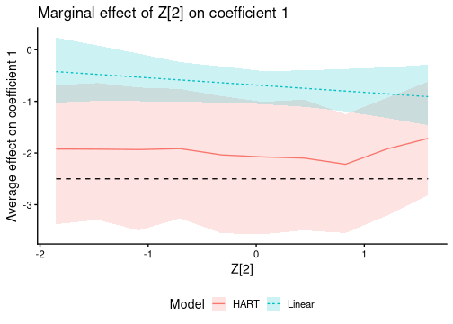
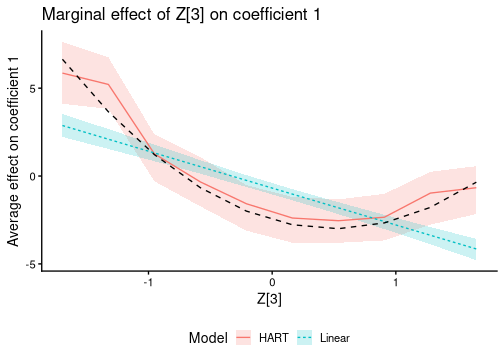
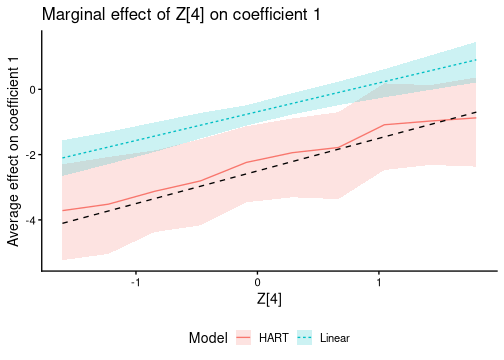

This vignette shows how to compute and plot marginal effects of covariates
$Z$ on the systematic component of the coefficients with `bayesm.HART`. It
compares a HART specification with a linear hierarchical specification.


``` r
library(bayesm.HART)
library(bayesm)
library(ggplot2)
```

## Data Simulation

The data come from a hierarchical multinomial logit in which the first
coefficient is a Friedman function of $Z$.


``` r
friedman_args <- list(coefs = c(10, 20, 10, 1), shift = -30, scale = 10)
sim <- sim_hier_mnl(nlgt = 300, nT = 20, p = 3, nz = 10, nXa = 1, nXd = 1,
                    beta_func_type = "friedman", beta_func_args = friedman_args,
                    seed = 1234)
Data <- list(p = sim$p, lgtdata = sim$lgtdata, Z = sim$Z)
```

## Model Estimation

We estimate two models:

1. Linear: $\beta_i = \Delta^\top Z_i + \varepsilon_i$, fitted with
   `bayesm::rhierMnlRwMixture`.
2. HART: $\beta_i = \Delta(Z_i) + \varepsilon_i$.

The chains are short to keep the vignette fast.


``` r
set.seed(2025)
Mcmc <- list(R = 8000, keep = 40)
burn <- 100  # kept draws to discard

out_linear <- bayesm::rhierMnlRwMixture(Data, Prior = list(ncomp = 1), Mcmc)
class(out_linear) <- "rhierMnlRwMixture"  # bayesm.HART methods for the bayesm fit

out_hart <- bayesm.HART::rhierMnlRwMixture(
  Data,
  Prior = list(ncomp = 1, hart_model = "normalized",
               bart = list(num_trees = 50, tau = 2, numcut = 50)),
  Mcmc
)
```

## Marginal Effects

Each of $Z_2$, $Z_3$ and $Z_4$ is varied over its range with the other
covariates held at their means. `marginal_effects()` returns the posterior
draws of the expected coefficients at each grid point; the true curve is the
Friedman function at the same points.


``` r
friedman <- function(z) with(friedman_args,
  (coefs[1] * sin(pi * z[1] * z[2]) + coefs[2] * (z[3] - 0.5)^2 +
     coefs[3] * z[4] + coefs[4] * z[5] + shift) / scale)

Z_mean <- t(colMeans(Data$Z))

for (j in c(2, 3, 4)) {
  # Grid over Z[j], the other covariates at their means
  grid <- seq(min(Data$Z[, j]), max(Data$Z[, j]), length.out = 10)
  z_values <- Z_mean[rep(1, length(grid)), ]
  z_values[, j] <- grid

  mfx_hart <- summary(marginal_effects(out_hart, z_values = z_values,
                                       Z = Z_mean, burn = burn))
  mfx_linear <- summary(marginal_effects(out_linear, z_values = z_values,
                                         Z = Z_mean, burn = burn))
  truth <- data.frame(z = grid, effect = apply(z_values, 1, friedman))

  print(
    plot(mfx_hart, Linear = mfx_linear, x_name = "HART",
         plot_axis_var = paste0("z_val_", j),
         xlab = paste0("Z[", j, "]"), ylab = "Average effect on coefficient 1",
         title = paste0("Marginal effect of Z[", j, "] on coefficient 1")) +
      geom_line(data = truth, aes(x = z, y = effect), linetype = "dashed",
                inherit.aes = FALSE) +
      theme_classic(base_size = 14) +
      theme(legend.position = "bottom")
  )
}
```







The plots show the estimated average effects of $Z_2$, $Z_3$ and $Z_4$ on
the first coefficient across each covariate's range. The HART curve
tracks the nonlinear true curve (black, dashed) more closely than the linear
specification. Shaded regions are 95% posterior credible intervals.
