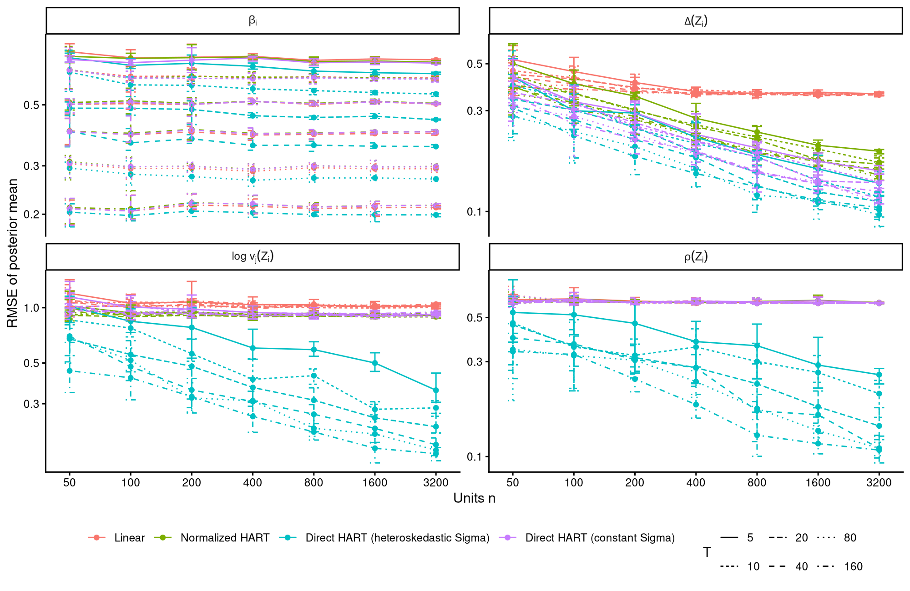
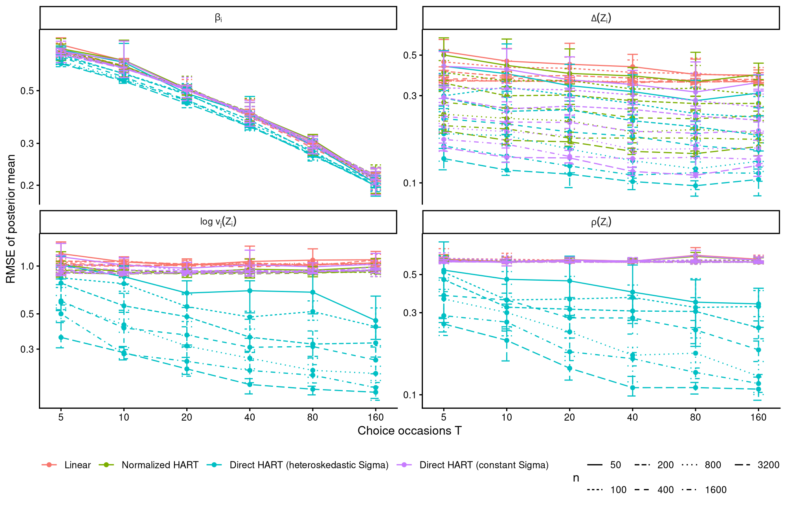
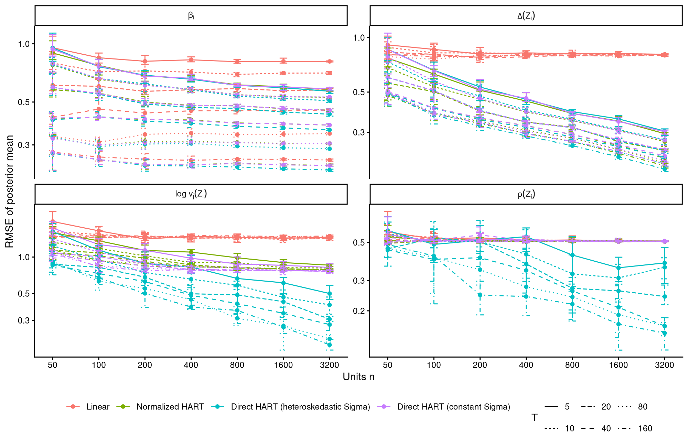
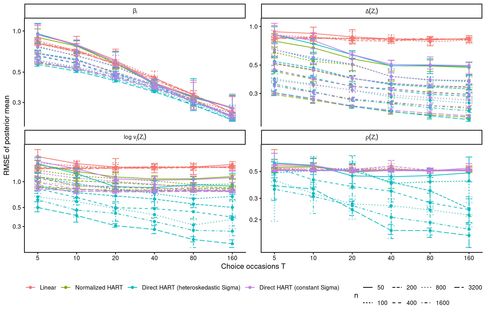

## Introduction

This article studies how the posterior means of a hierarchical logit model
behave as the number of units `n` and the number of choice occasions per
unit `T` grow. Two kinds of quantities are tracked: the individual
coefficients $\beta_i$, which are learned from unit $i$'s own choices and
therefore converge in `T`, and the population functions $\Delta(Z)$ and
$\Sigma(Z)$, which are learned across units and therefore converge in `n`.

Four specifications are compared on the same simulated data: the linear
hierarchical model of `bayesm`, the normalized HART model
(`hart_model = "normalized"`), the direct HART model with a global
covariance (`hart_model = "direct"`, `hart_cov = "constant"`), and the direct
HART model with covariate-dependent covariance trees
(`hart_cov = "heteroskedastic"`). The last two share the vector-leaf mean ensemble, so
their difference isolates the covariance model.


``` r
library(bayesm.HART)
library(dplyr)
#> 
#> Attaching package: 'dplyr'
#> The following objects are masked from 'package:stats':
#> 
#>     filter, lag
#> The following objects are masked from 'package:base':
#> 
#>     intersect, setdiff, setequal, union
library(tidyr)
library(ggplot2)
library(parallel)
```

## Designs

Two data-generating processes, each with two coefficients, differ in how
much of the coefficient heterogeneity the characteristics `Z` explain and
in how much of that a linear projection can capture.

- **step**: two characteristics; the mean of the first coefficient steps in
  $Z_1$, the second is constant. The step is three quarters linear in
  $Z_1$, so the linear model loses little.
- **friedman**: five characteristics; both coefficient means are scaled
  Friedman functions of `Z` (the second on a permutation of the columns),
  of which a linear projection captures about 60%. The unobserved
  heterogeneity is smaller, so shrinkage toward $\Delta(Z_i)$ matters more
  for $\beta_i$.

In both, the first variance is log-linear in $Z_1$ and the correlation
varies with $Z_2$.


``` r
sigma_fn <- function(s1, s2, b1, rho_max) function(Zi) {
  v <- c(s1 * exp(b1 * Zi[1]), s2)
  r <- rho_max * tanh(2 * Zi[2]) * sqrt(v[1] * v[2])
  matrix(c(v[1], r, r, v[2]), 2, 2)
}
friedman <- function(Zi)
  (10 * sin(pi * Zi[1] * Zi[2]) + 20 * (Zi[3] - 0.5)^2 + 10 * Zi[4] +
     5 * Zi[5]) / 8

designs <- list(
  step = list(
    nz    = 2L, seed = 0L,
    mean  = function(Zi) c(ifelse(Zi[1] > 0, 1, -1), 0.5),
    Sigma = sigma_fn(0.5, 0.5, b1 = 1.2, rho_max = 0.7)),
  friedman = list(
    nz    = 5L, seed = 100000000L,
    mean  = function(Zi) c(0.4 * friedman(Zi),
                           0.25 * friedman(Zi[c(3, 4, 5, 1, 2)])),
    Sigma = sigma_fn(0.25, 0.25, b1 = 1.0, rho_max = 0.6)))

# One data set per (design, n, T, replication); the seed encodes the cell.
cell_seed <- function(design, n, T, rep)
  designs[[design]]$seed + 10000000L * rep + 1000L * n + T
simulate_cell <- function(design, n, T, rep) {
  d <- designs[[design]]
  sim_hier_mnl(
    nlgt = n, nT = T, p = 3, nz = d$nz, nXa = 2, nXd = 0, const = FALSE,
    beta_func_type = "custom", beta_func_args = list(func = d$mean),
    Sigma_func = d$Sigma, seed = cell_seed(design, n, T, rep))
}
```

The share of coefficient variance explained by `Z`,
$R^2_d = \mathrm{Var}\{\Delta_d(Z)\} / [\mathrm{Var}\{\Delta_d(Z)\} + E\{\Sigma_{dd}(Z)\}]$,
and the share of $\mathrm{Var}\{\Delta_d(Z)\}$ that the best linear
predictor in `Z` captures, by Monte Carlo over the simulator's standardized
uniform characteristics:


``` r
design_r2 <- function(design, n = 20000L) {
  d <- designs[[design]]
  set.seed(1)
  Z <- scale(matrix(runif(n * d$nz, -1, 1), n, d$nz))
  Delta <- t(apply(Z, 1, d$mean))
  V <- t(apply(Z, 1, function(Zi) diag(d$Sigma(Zi))))
  data.frame(design = design, coefficient = 1:2,
             var_Delta = apply(Delta, 2, var), mean_Sigma = colMeans(V),
             R2 = apply(Delta, 2, var) / (apply(Delta, 2, var) + colMeans(V)),
             linear_share = sapply(1:2, function(k)
               summary(lm(Delta[, k] ~ Z))$r.squared))
}
print(do.call(rbind, lapply(names(designs), design_r2)), digits = 2,
      row.names = FALSE)
#>    design coefficient var_Delta mean_Sigma   R2 linear_share
#>      step           1      1.00       0.95 0.51         0.75
#>      step           2      0.00       0.50 0.00         0.50
#>  friedman           1      2.27       0.40 0.85         0.60
#>  friedman           2      0.86       0.25 0.78         0.59
```

The grid crosses seven sample sizes with six panel lengths, with five
replications per cell and design. Every chain runs 2,000 iterations keeping
every second draw; the first 500 kept draws are dropped. The HART models use
200 mean trees. The normalized model's ensemble scale is `tau = 2`, since
the Friedman means have standard deviations 1.5 and 0.9 and the default
`tau = 1` leaves $\Delta(Z)$ under-covered at large `n`; the direct models
learn their scales. The direct model with a constant covariance draws one
$\Sigma$ from its inverse-Wishart conditional in place of the variance and
off-diagonal ensembles.


``` r
grid <- expand.grid(design = names(designs),
                    n = c(50L, 100L, 200L, 400L, 800L, 1600L, 3200L),
                    T = c(5L, 10L, 20L, 40L, 80L, 160L), rep = 1:5,
                    stringsAsFactors = FALSE)
models <- c("linear", "normalized", "direct", "direct_constant")
R <- 2000L; keep <- 2L; burn <- 500L

prior_for <- function(model) {
  switch(model,
    linear     = list(ncomp = 1),
    normalized = list(ncomp = 1, hart_model = "normalized",
                      bart = list(num_trees = 200, tau = 2),
                      store_trees = FALSE),
    direct     = list(ncomp = 1, hart_model = "direct",
                      bart = list(num_trees = 200),
                      vartree = list(num_trees = 20),
                      phitree = list(num_trees = 20), store_trees = FALSE),
    direct_constant = list(ncomp = 1, hart_model = "direct",
                         hart_cov = "constant", bart = list(num_trees = 200),
                         store_trees = FALSE))
}
```

## Scoring a Fit

For every fit the posterior means of $\beta_i$, $\Delta(Z_i)$,
$\log v_j(Z_i)$ and $\rho(Z_i)$ at the training units are compared with
the truth by root mean squared error over units, and the coverage of
central 90% posterior intervals is recorded for $\beta_i$ and
$\Delta(Z_i)$. Models with a common covariance contribute their posterior
of $\Sigma$ at every unit.


``` r
posterior_mean <- function(a) apply(a, seq_len(length(dim(a)) - 1), mean)
coverage90 <- function(a, truth) {
  lo <- apply(a, c(1, 2), quantile, probs = 0.05)
  hi <- apply(a, c(1, 2), quantile, probs = 0.95)
  mean(lo <= truth & truth <= hi)
}

score_fit <- function(fit, sim, burn) {
  truth <- sim$true_values
  kept  <- (burn + 1):dim(fit$betadraw)[3]
  beta  <- fit$betadraw[, , kept, drop = FALSE]
  delta <- predict(fit, newdata = list(Z = sim$Z), type = "DeltaZ+mu",
                   burn = burn, r_verbose = FALSE)
  Sig   <- predict(fit, newdata = list(Z = sim$Z), type = "SigmaZ",
                   burn = burn, r_verbose = FALSE)
  St    <- truth$Sigma_true
  v1 <- Sig[, 1, 1, ]; v2 <- Sig[, 2, 2, ]; c12 <- Sig[, 1, 2, ]
  logv_hat  <- log(cbind(rowMeans(v1), rowMeans(v2)))
  logv_true <- log(cbind(St[, 1, 1], St[, 2, 2]))
  rho_hat   <- rowMeans(c12 / sqrt(v1 * v2))
  rho_true  <- St[, 1, 2] / sqrt(St[, 1, 1] * St[, 2, 2])
  data.frame(
    rmse_beta   = sqrt(mean((posterior_mean(beta) - truth$beta_true)^2)),
    cover_beta  = coverage90(beta, truth$beta_true),
    rmse_delta  = sqrt(mean((posterior_mean(delta) - truth$betabar_true)^2)),
    cover_delta = coverage90(delta, truth$betabar_true),
    rmse_logv   = sqrt(mean((logv_hat - logv_true)^2)),
    rmse_rho    = sqrt(mean((rho_hat - rho_true)^2)))
}
```

## Running the Grid

Every cell `(design, n, T, rep, model)` is cached as one file under the
package cache directory, so re-knitting reuses finished cells and
extending `designs`, `grid`, or `models` only fits what is new. Cells are
independent and run in parallel.


``` r
cache_dir <- file.path(vignette_cache_dir, "sim-convergence")
dir.create(cache_dir, showWarnings = FALSE)

score_cell <- function(design, n, T, rep, model) {
  file <- file.path(cache_dir, sprintf("%s-n%d-T%d-rep%d-%s.rds",
                                       design, n, T, rep, model))
  if (file.exists(file)) return(readRDS(file))
  sim <- simulate_cell(design, n, T, rep)
  set.seed(cell_seed(design, n, T, rep) + match(model, models))
  t0  <- Sys.time()
  capture.output(fit <- rhierMnlRwMixture(
    Data = sim, Prior = prior_for(model),
    Mcmc = list(R = R, keep = keep, nprint = 0), r_verbose = FALSE))
  out <- cbind(
    data.frame(design = design, n = n, T = T, rep = rep, model = model,
               seconds = as.numeric(Sys.time() - t0, units = "secs"),
               version = as.character(packageVersion("bayesm.HART")),
               stringsAsFactors = FALSE),
    score_fit(fit, sim, burn))
  saveRDS(out, file)
  out
}
```


``` r
cells  <- merge(grid, data.frame(model = models, stringsAsFactors = FALSE),
                by = NULL)
ncores <- if (.Platform$OS.type == "windows") 1L else
  max(1L, detectCores() - 1L)
rows   <- mclapply(seq_len(nrow(cells)), function(i)
  with(cells[i, ], score_cell(design, n, T, rep, model)), mc.cores = ncores)
failed <- !vapply(rows, is.data.frame, logical(1))
if (any(failed))
  stop(sprintf("%d of %d cells failed; first failure: %s", sum(failed),
               length(rows),
               conditionMessage(attr(rows[[which(failed)[1]]], "condition"))))
results <- do.call(rbind, rows)
results$model <- factor(results$model, levels = models,
                        labels = c("Linear", "Normalized HART",
                                   "Direct HART (heteroskedastic Sigma)",
                                   "Direct HART (constant Sigma)"))
cat(nrow(results), "cells;", round(sum(results$seconds) / 60),
    "minutes of sampling\n")
#> 1680 cells; 809 minutes of sampling
```

## Results

Root mean squared errors of the posterior means, averaged over
replications; the bars span the replications.


``` r
long <- results %>%
  select(design, model, n, T, rep, rmse_beta, rmse_delta, rmse_logv,
         rmse_rho) %>%
  pivot_longer(starts_with("rmse"), names_to = "target", values_to = "rmse") %>%
  mutate(target = factor(target,
    levels = c("rmse_beta", "rmse_delta", "rmse_logv", "rmse_rho"),
    labels = c("beta[i]", "Delta(Z[i])", "log~v[j](Z[i])", "rho(Z[i])")))
agg <- long %>%
  group_by(design, model, n, T, target) %>%
  summarise(mean = mean(rmse), lo = min(rmse), hi = max(rmse),
            .groups = "drop")

plot_rmse <- function(design, x, line) {
  dat <- agg[agg$design == design, ]
  dat$x <- dat[[x]]; dat$line <- factor(dat[[line]])
  ggplot(dat, aes(x = x, y = mean, colour = model, linetype = line)) +
    geom_line() +
    geom_point() +
    geom_errorbar(aes(ymin = lo, ymax = hi), width = 0.05) +
    facet_wrap(~ target, scales = "free_y", labeller = label_parsed) +
    scale_x_log10(breaks = unique(dat$x)) +
    scale_y_log10() +
    labs(x = if (x == "n") "Units n" else "Choice occasions T",
         y = "RMSE of posterior mean", colour = NULL, linetype = line) +
    theme_classic() +
    theme(legend.position = "bottom")
}
```

### Step design


``` r
plot_rmse("step", x = "n", line = "T")
```

<div class="figure" style="text-align: center">

<p class="caption">Step design: RMSE of posterior means against the number of units n, by panel length T.</p>
</div>


``` r
plot_rmse("step", x = "T", line = "n")
```

<div class="figure" style="text-align: center">

<p class="caption">Step design: RMSE of posterior means against the panel length T, by number of units n.</p>
</div>

The individual coefficients improve with `T` at every `n` and are flat in
`n`: at `T = 160` all models reach an RMSE near 0.2. Because the step is
mostly linear in $Z_1$ and the unobserved heterogeneity is as large as the
explained part, the linear and normalized models shrink toward similar
targets and their $\beta_i$ errors coincide. The two direct models separate
the two ingredients of the direct specification. With a constant covariance,
the vector-leaf mean leaves $\beta_i$ where the normalized model has it but
lowers the error in $\Delta(Z_i)$ by 15 to 20 percent, since one partition
serves both coefficients. The covariance trees then lower $\beta_i$ by a
further 7 to 13 percent at short panels and $\Delta(Z_i)$ by 13 to 28
percent: $v_1(Z)$ varies by more than an order of magnitude across $Z_1$,
and the shrinkage weights follow it. The population mean reaches 0.10
(direct, heteroskedastic covariance), 0.12 (direct, constant covariance), and 0.15
(normalized) at `n = 3200`, while the linear model levels off at 0.36. Only
the direct model with covariance trees improves in $\log v_j(Z_i)$ and
$\rho(Z_i)$, since the other three hold $\Sigma$ constant.

### Friedman design


``` r
plot_rmse("friedman", x = "n", line = "T")
```

<div class="figure" style="text-align: center">

<p class="caption">Friedman design: RMSE of posterior means against the number of units n, by panel length T.</p>
</div>


``` r
plot_rmse("friedman", x = "T", line = "n")
```

<div class="figure" style="text-align: center">

<p class="caption">Friedman design: RMSE of posterior means against the panel length T, by number of units n.</p>
</div>

Here `Z` explains most of the heterogeneity and a line captures only part
of $\Delta(Z)$, so the shrinkage target matters: once `n` is large enough
for the trees to learn $\Delta(Z)$, the HART models' $\beta_i$ errors fall
below the linear model's at every `T`, most visibly at short panels. At
`T = 5` and `n = 3200` the HART error is 0.57 against 0.81 for the linear
model; at `T = 160` the gap closes to 0.22 against 0.25 as the likelihood
takes over. $\Delta(Z_i)$ falls steadily in `n` for the HART models, to
0.19 to 0.20 at `n = 3200`, `T = 160`, while the linear model stays at
0.80. Here the three HART specifications are nearly indistinguishable in
$\beta_i$ and $\Delta(Z_i)$: the constant-covariance direct model tracks the
normalized model within 3 percent, and the covariance trees lower $\beta_i$
by at most 6 percent at the largest `n`. The unobserved heterogeneity is a
smaller share of the variation than in the step design, so how its
covariance is modeled matters less for the coefficients. The covariance
model shows in $\log v_j(Z_i)$ and $\rho(Z_i)$, which reach 0.19 and 0.15
in the largest cell under the heteroskedastic covariance and need both `n` and `T`.

### Coverage

Coverage of central 90% posterior intervals, averaged over units,
coefficients, and replications: first for the individual coefficients
$\beta_i$, then for the population means $\Delta(Z_i)$. Intervals for
$\beta_i$ cover between 0.85 and 0.93 throughout. For $\Delta(Z_i)$ the HART
intervals stay near nominal in the step design and drift down to 0.81 to
0.85 at `n = 3200` in the Friedman design, where the ensembles'
approximation error starts to dominate the posterior spread; the linear
model's intervals for $\Delta(Z_i)$ collapse as `n` grows.


``` r
coverage_table <- function(column) {
  results %>%
    group_by(design, model, n, T) %>%
    summarise(coverage = mean(.data[[column]]), .groups = "drop") %>%
    pivot_wider(names_from = model, values_from = coverage) %>%
    arrange(design, T, n) %>%
    as.data.frame()
}
print(coverage_table("cover_beta"), digits = 2, row.names = FALSE)
#>    design    n   T Linear Normalized HART Direct HART (heteroskedastic Sigma)
#>  friedman   50   5   0.92            0.93                                0.88
#>  friedman  100   5   0.90            0.93                                0.92
#>  friedman  200   5   0.87            0.93                                0.90
#>  friedman  400   5   0.87            0.93                                0.89
#>  friedman  800   5   0.88            0.93                                0.89
#>  friedman 1600   5   0.87            0.92                                0.89
#>  friedman 3200   5   0.88            0.91                                0.89
#>  friedman   50  10   0.86            0.88                                0.85
#>  friedman  100  10   0.89            0.91                                0.89
#>  friedman  200  10   0.88            0.91                                0.88
#>  friedman  400  10   0.88            0.90                                0.87
#>  friedman  800  10   0.88            0.91                                0.90
#>  friedman 1600  10   0.87            0.90                                0.87
#>  friedman 3200  10   0.88            0.89                                0.88
#>  friedman   50  20   0.87            0.89                                0.87
#>  friedman  100  20   0.88            0.89                                0.90
#>  friedman  200  20   0.89            0.92                                0.90
#>  friedman  400  20   0.88            0.90                                0.89
#>  friedman  800  20   0.88            0.89                                0.88
#>  friedman 1600  20   0.88            0.89                                0.89
#>  friedman 3200  20   0.88            0.89                                0.88
#>  friedman   50  40   0.91            0.91                                0.91
#>  friedman  100  40   0.88            0.91                                0.88
#>  friedman  200  40   0.89            0.90                                0.90
#>  friedman  400  40   0.88            0.89                                0.89
#>  friedman  800  40   0.88            0.89                                0.89
#>  friedman 1600  40   0.88            0.89                                0.89
#>  friedman 3200  40   0.88            0.89                                0.88
#>  friedman   50  80   0.90            0.91                                0.89
#>  friedman  100  80   0.91            0.91                                0.91
#>  friedman  200  80   0.88            0.89                                0.90
#>  friedman  400  80   0.89            0.89                                0.89
#>  friedman  800  80   0.89            0.89                                0.89
#>  friedman 1600  80   0.89            0.89                                0.89
#>  friedman 3200  80   0.89            0.89                                0.89
#>  friedman   50 160   0.89            0.90                                0.91
#>  friedman  100 160   0.88            0.89                                0.89
#>  friedman  200 160   0.89            0.89                                0.89
#>  friedman  400 160   0.89            0.89                                0.89
#>  friedman  800 160   0.89            0.89                                0.89
#>  friedman 1600 160   0.89            0.89                                0.89
#>  friedman 3200 160   0.89            0.89                                0.89
#>      step   50   5   0.92            0.92                                0.91
#>      step  100   5   0.90            0.92                                0.92
#>      step  200   5   0.90            0.91                                0.90
#>      step  400   5   0.88            0.88                                0.90
#>      step  800   5   0.89            0.87                                0.91
#>      step 1600   5   0.88            0.86                                0.89
#>      step 3200   5   0.89            0.88                                0.90
#>      step   50  10   0.89            0.88                                0.90
#>      step  100  10   0.90            0.90                                0.90
#>      step  200  10   0.88            0.87                                0.89
#>      step  400  10   0.89            0.88                                0.90
#>      step  800  10   0.88            0.87                                0.90
#>      step 1600  10   0.88            0.87                                0.89
#>      step 3200  10   0.88            0.88                                0.90
#>      step   50  20   0.88            0.89                                0.90
#>      step  100  20   0.90            0.89                                0.90
#>      step  200  20   0.89            0.89                                0.91
#>      step  400  20   0.88            0.88                                0.90
#>      step  800  20   0.89            0.88                                0.90
#>      step 1600  20   0.89            0.88                                0.89
#>      step 3200  20   0.89            0.88                                0.90
#>      step   50  40   0.88            0.88                                0.88
#>      step  100  40   0.88            0.88                                0.90
#>      step  200  40   0.89            0.88                                0.89
#>      step  400  40   0.88            0.88                                0.89
#>      step  800  40   0.88            0.88                                0.90
#>      step 1600  40   0.89            0.88                                0.90
#>      step 3200  40   0.88            0.88                                0.89
#>      step   50  80   0.87            0.87                                0.88
#>      step  100  80   0.88            0.88                                0.90
#>      step  200  80   0.88            0.88                                0.89
#>      step  400  80   0.89            0.89                                0.91
#>      step  800  80   0.89            0.88                                0.89
#>      step 1600  80   0.89            0.88                                0.89
#>      step 3200  80   0.89            0.88                                0.89
#>      step   50 160   0.89            0.87                                0.89
#>      step  100 160   0.89            0.88                                0.90
#>      step  200 160   0.89            0.88                                0.89
#>      step  400 160   0.89            0.89                                0.89
#>      step  800 160   0.89            0.88                                0.89
#>      step 1600 160   0.89            0.89                                0.89
#>      step 3200 160   0.89            0.89                                0.89
#>  Direct HART (constant Sigma)
#>                          0.90
#>                          0.92
#>                          0.93
#>                          0.91
#>                          0.92
#>                          0.91
#>                          0.90
#>                          0.86
#>                          0.89
#>                          0.90
#>                          0.90
#>                          0.91
#>                          0.89
#>                          0.89
#>                          0.88
#>                          0.88
#>                          0.91
#>                          0.89
#>                          0.89
#>                          0.89
#>                          0.89
#>                          0.90
#>                          0.90
#>                          0.90
#>                          0.89
#>                          0.89
#>                          0.89
#>                          0.88
#>                          0.91
#>                          0.91
#>                          0.90
#>                          0.89
#>                          0.89
#>                          0.89
#>                          0.88
#>                          0.89
#>                          0.89
#>                          0.89
#>                          0.89
#>                          0.89
#>                          0.89
#>                          0.89
#>                          0.92
#>                          0.93
#>                          0.91
#>                          0.89
#>                          0.90
#>                          0.88
#>                          0.89
#>                          0.89
#>                          0.90
#>                          0.88
#>                          0.89
#>                          0.88
#>                          0.88
#>                          0.88
#>                          0.90
#>                          0.90
#>                          0.90
#>                          0.88
#>                          0.88
#>                          0.89
#>                          0.88
#>                          0.88
#>                          0.88
#>                          0.88
#>                          0.88
#>                          0.88
#>                          0.88
#>                          0.88
#>                          0.86
#>                          0.88
#>                          0.88
#>                          0.89
#>                          0.88
#>                          0.89
#>                          0.88
#>                          0.88
#>                          0.90
#>                          0.89
#>                          0.89
#>                          0.88
#>                          0.89
#>                          0.89
print(coverage_table("cover_delta"), digits = 2, row.names = FALSE)
#>    design    n   T Linear Normalized HART Direct HART (heteroskedastic Sigma)
#>  friedman   50   5  0.762            0.94                                0.80
#>  friedman  100   5  0.573            0.92                                0.86
#>  friedman  200   5  0.382            0.92                                0.86
#>  friedman  400   5  0.280            0.92                                0.89
#>  friedman  800   5  0.192            0.91                                0.86
#>  friedman 1600   5  0.130            0.87                                0.84
#>  friedman 3200   5  0.092            0.86                                0.81
#>  friedman   50  10  0.626            0.91                                0.83
#>  friedman  100  10  0.468            0.92                                0.88
#>  friedman  200  10  0.320            0.92                                0.89
#>  friedman  400  10  0.212            0.90                                0.90
#>  friedman  800  10  0.146            0.89                                0.86
#>  friedman 1600  10  0.104            0.84                                0.82
#>  friedman 3200  10  0.075            0.84                                0.81
#>  friedman   50  20  0.528            0.91                                0.85
#>  friedman  100  20  0.405            0.89                                0.86
#>  friedman  200  20  0.282            0.92                                0.91
#>  friedman  400  20  0.180            0.90                                0.90
#>  friedman  800  20  0.123            0.86                                0.85
#>  friedman 1600  20  0.090            0.86                                0.85
#>  friedman 3200  20  0.066            0.84                                0.81
#>  friedman   50  40  0.512            0.92                                0.89
#>  friedman  100  40  0.370            0.93                                0.91
#>  friedman  200  40  0.262            0.92                                0.92
#>  friedman  400  40  0.178            0.88                                0.88
#>  friedman  800  40  0.120            0.86                                0.87
#>  friedman 1600  40  0.080            0.85                                0.84
#>  friedman 3200  40  0.056            0.85                                0.81
#>  friedman   50  80  0.534            0.90                                0.85
#>  friedman  100  80  0.358            0.92                                0.91
#>  friedman  200  80  0.260            0.90                                0.89
#>  friedman  400  80  0.169            0.89                                0.90
#>  friedman  800  80  0.116            0.87                                0.86
#>  friedman 1600  80  0.079            0.85                                0.84
#>  friedman 3200  80  0.054            0.85                                0.81
#>  friedman   50 160  0.526            0.91                                0.89
#>  friedman  100 160  0.345            0.91                                0.89
#>  friedman  200 160  0.203            0.89                                0.88
#>  friedman  400 160  0.151            0.88                                0.88
#>  friedman  800 160  0.109            0.87                                0.87
#>  friedman 1600 160  0.074            0.86                                0.85
#>  friedman 3200 160  0.051            0.85                                0.81
#>      step   50   5  0.800            0.95                                0.92
#>      step  100   5  0.664            0.97                                0.96
#>      step  200   5  0.590            0.97                                0.94
#>      step  400   5  0.606            0.97                                0.97
#>      step  800   5  0.591            0.96                                0.97
#>      step 1600   5  0.476            0.96                                0.96
#>      step 3200   5  0.511            0.94                                0.96
#>      step   50  10  0.744            0.93                                0.93
#>      step  100  10  0.681            0.96                                0.93
#>      step  200  10  0.598            0.95                                0.95
#>      step  400  10  0.565            0.96                                0.95
#>      step  800  10  0.496            0.96                                0.94
#>      step 1600  10  0.544            0.95                                0.96
#>      step 3200  10  0.526            0.94                                0.97
#>      step   50  20  0.720            0.95                                0.91
#>      step  100  20  0.661            0.94                                0.93
#>      step  200  20  0.555            0.95                                0.94
#>      step  400  20  0.622            0.95                                0.95
#>      step  800  20  0.511            0.95                                0.96
#>      step 1600  20  0.450            0.96                                0.97
#>      step 3200  20  0.525            0.94                                0.97
#>      step   50  40  0.694            0.93                                0.92
#>      step  100  40  0.638            0.93                                0.93
#>      step  200  40  0.632            0.94                                0.95
#>      step  400  40  0.565            0.96                                0.95
#>      step  800  40  0.565            0.96                                0.97
#>      step 1600  40  0.558            0.95                                0.97
#>      step 3200  40  0.482            0.95                                0.97
#>      step   50  80  0.728            0.96                                0.95
#>      step  100  80  0.668            0.93                                0.94
#>      step  200  80  0.628            0.94                                0.95
#>      step  400  80  0.544            0.95                                0.96
#>      step  800  80  0.529            0.95                                0.98
#>      step 1600  80  0.476            0.95                                0.95
#>      step 3200  80  0.434            0.95                                0.95
#>      step   50 160  0.722            0.92                                0.93
#>      step  100 160  0.642            0.94                                0.95
#>      step  200 160  0.619            0.95                                0.96
#>      step  400 160  0.528            0.95                                0.96
#>      step  800 160  0.492            0.96                                0.96
#>      step 1600 160  0.484            0.95                                0.96
#>      step 3200 160  0.514            0.94                                0.95
#>  Direct HART (constant Sigma)
#>                          0.83
#>                          0.87
#>                          0.91
#>                          0.89
#>                          0.90
#>                          0.87
#>                          0.84
#>                          0.81
#>                          0.88
#>                          0.91
#>                          0.90
#>                          0.87
#>                          0.86
#>                          0.83
#>                          0.88
#>                          0.87
#>                          0.93
#>                          0.92
#>                          0.87
#>                          0.86
#>                          0.84
#>                          0.91
#>                          0.93
#>                          0.93
#>                          0.89
#>                          0.88
#>                          0.85
#>                          0.84
#>                          0.87
#>                          0.92
#>                          0.91
#>                          0.90
#>                          0.88
#>                          0.86
#>                          0.85
#>                          0.90
#>                          0.91
#>                          0.89
#>                          0.89
#>                          0.88
#>                          0.87
#>                          0.85
#>                          0.92
#>                          0.97
#>                          0.95
#>                          0.97
#>                          0.96
#>                          0.95
#>                          0.93
#>                          0.89
#>                          0.95
#>                          0.95
#>                          0.96
#>                          0.94
#>                          0.95
#>                          0.93
#>                          0.90
#>                          0.91
#>                          0.95
#>                          0.94
#>                          0.94
#>                          0.96
#>                          0.94
#>                          0.92
#>                          0.92
#>                          0.94
#>                          0.95
#>                          0.96
#>                          0.95
#>                          0.96
#>                          0.96
#>                          0.94
#>                          0.94
#>                          0.95
#>                          0.96
#>                          0.95
#>                          0.95
#>                          0.92
#>                          0.95
#>                          0.95
#>                          0.95
#>                          0.95
#>                          0.95
#>                          0.94
```

## Runtime

Seconds per fit, averaged over replications.


``` r
results %>%
  group_by(design, model, n, T) %>%
  summarise(seconds = mean(seconds), .groups = "drop") %>%
  pivot_wider(names_from = model, values_from = seconds) %>%
  arrange(design, T, n) %>%
  as.data.frame() %>%
  print(digits = 2, row.names = FALSE)
#>    design    n   T Linear Normalized HART Direct HART (heteroskedastic Sigma)
#>  friedman   50   5   0.22             2.0                                 4.9
#>  friedman  100   5   0.41             3.5                                 7.1
#>  friedman  200   5   0.79             6.6                                11.0
#>  friedman  400   5   1.50            12.5                                18.6
#>  friedman  800   5   2.96            24.0                                33.9
#>  friedman 1600   5   5.90            46.9                                64.3
#>  friedman 3200   5  11.86            93.8                               125.9
#>  friedman   50  10   0.24             2.0                                 4.9
#>  friedman  100  10   0.44             3.6                                 7.1
#>  friedman  200  10   0.89             6.8                                11.1
#>  friedman  400  10   1.74            12.7                                18.8
#>  friedman  800  10   3.37            24.4                                34.2
#>  friedman 1600  10   6.71            47.7                                65.2
#>  friedman 3200  10  13.65            95.4                               127.6
#>  friedman   50  20   0.27             2.0                                 4.9
#>  friedman  100  20   0.51             3.7                                 7.1
#>  friedman  200  20   1.04             6.9                                11.2
#>  friedman  400  20   1.95            13.0                                19.1
#>  friedman  800  20   3.94            24.9                                34.8
#>  friedman 1600  20   8.06            49.2                                66.5
#>  friedman 3200  20  16.14            97.9                               130.3
#>  friedman   50  40   0.34             2.1                                 5.0
#>  friedman  100  40   0.64             3.9                                 7.3
#>  friedman  200  40   1.27             7.1                                11.5
#>  friedman  400  40   2.49            13.4                                20.0
#>  friedman  800  40   5.18            26.1                                36.2
#>  friedman 1600  40  10.30            51.3                                68.5
#>  friedman 3200  40  21.23           103.0                               134.9
#>  friedman   50  80   0.48             2.2                                 5.1
#>  friedman  100  80   0.93             4.1                                 7.5
#>  friedman  200  80   1.83             7.7                                12.1
#>  friedman  400  80   3.68            14.7                                20.8
#>  friedman  800  80   7.37            28.3                                38.3
#>  friedman 1600  80  14.83            55.8                                73.3
#>  friedman 3200  80  32.79           114.2                               145.7
#>  friedman   50 160   0.77             2.5                                 5.4
#>  friedman  100 160   1.43             4.6                                 8.1
#>  friedman  200 160   2.91             8.8                                13.2
#>  friedman  400 160   5.88            16.7                                23.0
#>  friedman  800 160  11.80            32.7                                42.6
#>  friedman 1600 160  24.70            65.7                                83.1
#>  friedman 3200 160  54.37           134.7                               167.1
#>      step   50   5   0.24             1.7                                 4.8
#>      step  100   5   0.42             3.3                                 6.9
#>      step  200   5   0.76             6.3                                11.1
#>      step  400   5   1.46            12.2                                18.8
#>      step  800   5   2.93            23.6                                34.1
#>      step 1600   5   5.89            46.7                                64.7
#>      step 3200   5  11.75            93.2                               126.5
#>      step   50  10   0.23             1.8                                 4.8
#>      step  100  10   0.43             3.3                                 7.0
#>      step  200  10   0.83             6.5                                11.1
#>      step  400  10   1.65            12.3                                19.0
#>      step  800  10   3.36            24.2                                34.4
#>      step 1600  10   6.65            47.6                                65.6
#>      step 3200  10  13.30            94.2                               127.8
#>      step   50  20   0.26             1.8                                 4.9
#>      step  100  20   0.50             3.5                                 7.2
#>      step  200  20   0.99             6.6                                11.3
#>      step  400  20   1.93            12.8                                19.3
#>      step  800  20   3.98            24.7                                35.1
#>      step 1600  20   7.82            48.5                                66.4
#>      step 3200  20  15.89            96.2                               130.2
#>      step   50  40   0.32             1.8                                 4.9
#>      step  100  40   0.63             3.6                                 7.2
#>      step  200  40   1.25             6.8                                11.6
#>      step  400  40   2.46            13.2                                19.8
#>      step  800  40   5.06            25.8                                36.3
#>      step 1600  40  10.24            50.7                                69.1
#>      step 3200  40  20.92           101.3                               136.3
#>      step   50  80   0.47             2.0                                 5.1
#>      step  100  80   0.91             3.9                                 7.5
#>      step  200  80   1.83             7.4                                12.1
#>      step  400  80   3.63            14.3                                21.0
#>      step  800  80   7.30            28.1                                38.4
#>      step 1600  80  14.91            55.5                                73.6
#>      step 3200  80  31.84           112.3                               146.0
#>      step   50 160   0.74             2.3                                 5.4
#>      step  100 160   1.43             4.4                                 8.1
#>      step  200 160   2.86             8.5                                13.2
#>      step  400 160   5.82            16.5                                22.9
#>      step  800 160  11.83            32.4                                42.9
#>      step 1600 160  24.47            65.1                                83.6
#>      step 3200 160  54.47           134.2                               167.7
#>  Direct HART (constant Sigma)
#>                           4.6
#>                           6.5
#>                          10.0
#>                          16.9
#>                          30.0
#>                          56.9
#>                         110.9
#>                           4.6
#>                           6.6
#>                          10.2
#>                          16.8
#>                          30.6
#>                          57.4
#>                         112.7
#>                           4.6
#>                           6.6
#>                          10.3
#>                          17.2
#>                          31.1
#>                          59.0
#>                         115.3
#>                           4.7
#>                           6.7
#>                          10.5
#>                          17.8
#>                          32.3
#>                          61.2
#>                         119.6
#>                           4.8
#>                           7.0
#>                          11.0
#>                          18.9
#>                          34.3
#>                          65.6
#>                         130.2
#>                           5.1
#>                           7.5
#>                          12.1
#>                          20.9
#>                          38.4
#>                          75.2
#>                         152.1
#>                           4.5
#>                           6.5
#>                           9.9
#>                          16.8
#>                          30.2
#>                          57.2
#>                         111.6
#>                           4.5
#>                           6.5
#>                          10.1
#>                          16.9
#>                          30.8
#>                          57.6
#>                         112.6
#>                           4.5
#>                           6.6
#>                          10.3
#>                          17.6
#>                          31.2
#>                          59.1
#>                         115.2
#>                           4.6
#>                           6.8
#>                          10.6
#>                          17.8
#>                          32.4
#>                          61.6
#>                         120.1
#>                           4.8
#>                           6.9
#>                          11.1
#>                          18.9
#>                          34.6
#>                          65.7
#>                         130.2
#>                           5.0
#>                           7.6
#>                          12.2
#>                          20.9
#>                          38.9
#>                          74.8
#>                         151.8
```

## Extending the Study

Each cell lives in its own file named by `(design, n, T, rep, model)`. To
add replications, grid points, a design, or a specification, extend
`grid`, `designs`, or `prior_for()` and re-knit: finished cells are read
from the cache and only the new ones are fitted. Deleting a cell's file
refits it.
